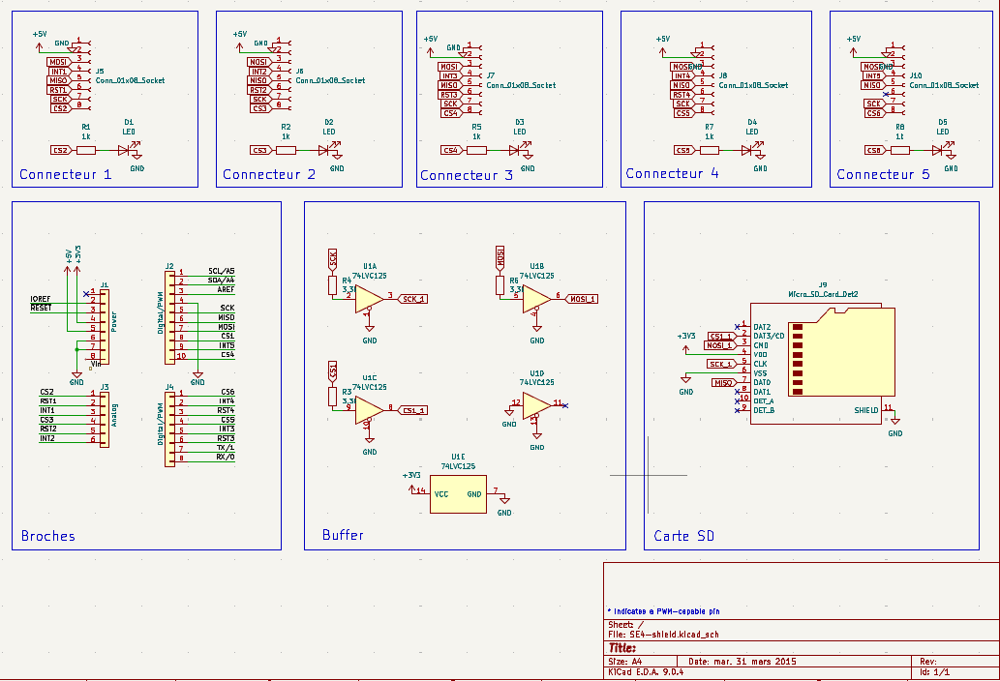
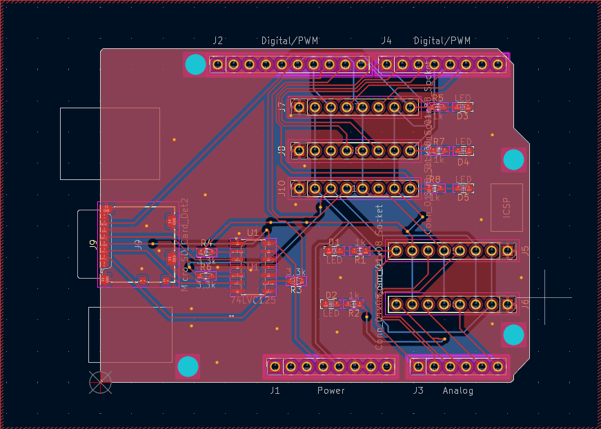

# Ordonnanceur minimal pour ATmega328P

Ordonnanceur écrit en C pour un microcontrôleur **ATmega328P** (Arduino Uno, 16 MHz), accompagné d'un shield Arduino conçu sous **KiCad**.

Plusieurs tâches s'exécutent « en parallèle » sur un seul cœur : un timer déclenche toutes les millisecondes un changement de contexte, qui sauvegarde les registres de la tâche courante et restaure ceux de la suivante (*round-robin*).

## Sommaire

- [Contexte](#contexte)
- [Aperçu](#aperçu)
- [Fonctionnalités](#fonctionnalités)
- [Structure du projet](#structure-du-projet)
- [Matériel](#matériel)
- [Compilation et téléversement](#compilation-et-téléversement)
- [Utilisation](#utilisation)
- [Fonctionnement interne](#fonctionnement-interne)
- [Limites](#limites)
- [Crédits](#crédits)

## Contexte

Le shield, branché sur l'Arduino Uno, joue le rôle de « carte mère » : il sert à tester l'ordonnanceur, qui tourne sur l'ATmega328P de l'Arduino.

Le shield et l'ordonnanceur sont terminés et testés : LEDs, lecteur de carte SD, communication série et SPI.

## Aperçu

### Schématique



### Routage



### Démonstration

[▶ Vidéo de démonstration](docs/demo.mp4) : lancement et arrêt des tâches (LEDs et afficheur 7 segments) depuis le terminal série.

## Fonctionnalités

- Changement de contexte déclenché par l'interruption du timer 1 (quantum de 1 ms)
- Création, suppression et fin de tâches à l'exécution (`add`, `kill`, `finish`)
- Mise en veille d'une tâche pendant une durée en millisecondes (`wait`)
- Une tâche d'interface série qui permet de lancer et d'arrêter les autres tâches depuis un terminal
- Tâches de démonstration : 5 LEDs clignotant à des rythmes différents et un afficheur 7 segments piloté en SPI

## Structure du projet

```text
.
├── docs/
│   ├── schematique.png        # Schématique du shield
│   ├── routage.png            # Routage du shield
│   └── demo.mp4               # Vidéo de démonstration
├── hardware/
│   ├── SE4-shield.kicad_pro   # Projet KiCad
│   ├── SE4-shield.kicad_sch   # Schéma
│   └── SE4-shield.kicad_pcb   # Circuit imprimé
└── software/
    ├── ordonnanceur.c         # Ordonnanceur, tâches de démonstration, main
    ├── ordonnanceur.h         # Constantes, structure des tâches, macros de contexte
    ├── test.c                 # Programme de test autonome de l'afficheur 7 segments (SPI)
    └── Makefile
```

## Matériel

Le dossier `hardware/` contient un shield pour Arduino Uno R3, créé à partir du modèle de shield fourni avec KiCad : 5 LEDs avec leurs résistances, un lecteur de carte micro SD, un buffer 74LVC125 et des connecteurs pour modules SPI (lignes `CS`, `INT` et `RST` dédiées).

Le logiciel pilote en SPI un afficheur 7 segments SparkFun. Affectation des broches utilisées :

| Élément                    | Broche |
|----------------------------|--------|
| LED 1                      | PC0    |
| LED 2                      | PC3    |
| LED 3                      | PB0    |
| LED 4                      | PD4    |
| LED 5                      | PD7    |
| SPI MOSI                   | PB3    |
| SPI MISO                   | PB4    |
| SPI SCK                    | PB5    |
| Afficheur 7 segments (CS4) | PB0    |

## Compilation et téléversement

Depuis le dossier `software/` :

```bash
make          # produit ordonnanceur.hex
make flash    # téléverse sur la carte
make clean    # supprime les fichiers .elf et .hex
```

La cible est un ATmega328P cadencé à 16 MHz. Le port série du téléversement est `/dev/ttyACM0` par défaut ; pour en changer :

```bash
make flash PORT=/dev/ttyUSB0
```

## Utilisation

Au démarrage, seule la tâche d'interface série est active. Ouvrez un terminal série sur la carte (par exemple avec `minicom` ou `screen`) avec les paramètres **9600 bauds, 8 bits de données, pas de parité, 2 bits de stop** :

```bash
minicom -D /dev/ttyACM0 -b 9600
```

Chaque caractère reçu est interprété comme une commande, puis renvoyé en écho :

| Caractère | Action                                 |
|-----------|----------------------------------------|
| `1` à `5` | Lancer le clignotement de la LED 1 à 5 |
| `6`       | Arrêter la LED 1                       |
| `7`       | Arrêter la LED 2                       |
| `8`       | Arrêter la LED 3                       |
| `9`       | Arrêter la LED 4                       |
| `0`       | Arrêter la LED 5                       |
| `s`       | Lancer l'affichage 7 segments          |
| `d`       | Arrêter l'affichage 7 segments         |

## Fonctionnement interne

- **Timer** : le timer 1 est configuré en mode CTC avec un diviseur de 8 et une période de 1 ms. Son interruption (`TIMER1_COMPA_vect`) est le point d'entrée de l'ordonnanceur.
- **Table des tâches** : `Tasks_list` contient, pour chaque tâche, le pointeur de pile sauvegardé, l'adresse de la fonction, le temps de veille restant et l'état (`RUN` ou `ENDED`).
- **Changement de contexte** : l'interruption est déclarée `naked`. Les macros `SAVE_REGISTERS()` et `RESTORE_REGISTERS()` empilent et dépilent `r0` à `r31` ainsi que `SREG`, et le pointeur de pile `SP` est échangé entre deux tâches.
- **Choix de la tâche suivante** : `scheduler()` décrémente les temps de veille, puis parcourt la table en ignorant les tâches en veille ou terminées.
- **Piles** : chaque tâche dispose de sa propre pile de 100 octets, placée à partir de l'adresse `0x800` et décalée de 100 octets par tâche. Une nouvelle tâche reçoit une pile pré-remplie (adresse de départ et registres) pour qu'un retour d'interruption la démarre directement.
- **Appels bloquants** : `wait()` et `finish()` déclenchent immédiatement un changement de contexte en appelant la routine d'interruption, sans attendre le prochain tick.

## Limites

- 15 tâches au maximum (`NBTASKS`), dont la tâche d'interface série
- 100 octets de pile par tâche (`STACK_LENGTH`), dont environ 35 sont consommés par la sauvegarde du contexte
- Durée maximale de `wait()` : 32 000 ms (entier 16 bits)
- Les délais `_delay_ms` des tâches sont ralentis par les changements de contexte : le clignotement réel est plus lent que le délai demandé, d'autant plus qu'il y a de tâches actives
- La tâche série attend les caractères en boucle : un caractère reçu pendant qu'elle n'est pas en cours d'exécution risque d'être perdu
- Pas de gestion de priorités

## Crédits

- Thomas Delobelle
